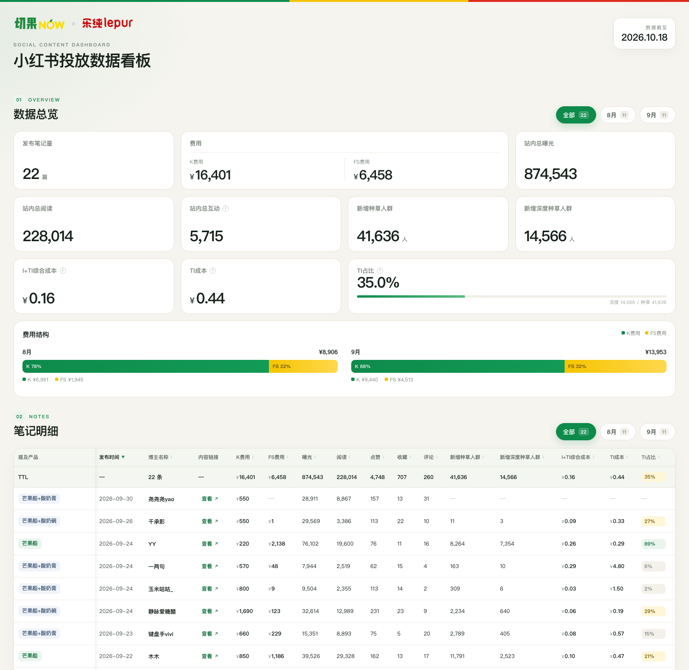

# Y26M8M9小红书投放数据看板

公开在线看板：**https://7383942.github.io/qieguo-lechun-dashboard/**

数据截至：2026-10-18

## 说明

- 单文件静态看板，包含数据总览、笔记明细、投放期间销售拉升三个模块。
- 品牌 logo、看板数据均已内嵌在 `index.html` 中，无外部依赖。
- 页面内「补充说明」通过 Cloudflare Worker + KV 共享存储：管理员保存后，所有访客在约 15 秒内自动看到最新内容。
- 管理员密码在 Worker 服务端校验，不写在前端页面源码里。
- 更新数据后替换 `index.html` 并推送到 `main`，GitHub Pages 会自动重新构建，通常 1 分钟内生效。

